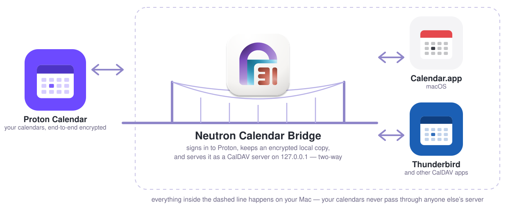
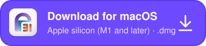
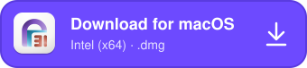

# Neutron Calendar Bridge

**Proton Calendar in Calendar.app and Thunderbird — on your Mac, two-way, end-to-end encrypted.**

If you use Proton Calendar and have been waiting for it to show up in Calendar.app like your other calendars — with widgets, notifications, invitations, offline access, Siri and all the apps that build on Calendar.app — this is the app you were waiting for. Proton Mail Bridge does this for mail; nothing official does it for calendar. Neutron Calendar Bridge is that missing piece: a small menu-bar app that signs in to Proton, keeps an encrypted copy of your calendars on your Mac and serves them to Calendar.app, Thunderbird or any other CalDAV app, with changes flowing both ways.

Unofficial: not affiliated with or endorsed by Proton AG (Proton, Proton Calendar and Proton Mail are trademarks of Proton AG). It talks to Proton's servers the way Proton's own apps do, under its own name. Free and open source (GPL-3.0), a fork of [proton-calendar-sync](https://github.com/TactlessAutist/proton-calendar-sync) and the [proton-calendar-client](https://github.com/TactlessAutist/proton-calendar-client) library it builds on by [**Tactless Autist**](https://github.com/TactlessAutist).

## Install

&nbsp;&nbsp;

Direct downloads of the newest version — [Apple silicon (M1 and later)](https://github.com/to-bi-s/neutron-calendar-bridge/releases/latest/download/neutron-calendar-bridge-arm64.dmg) · [Intel](https://github.com/to-bi-s/neutron-calendar-bridge/releases/latest/download/neutron-calendar-bridge-x64.dmg) · [all versions](https://github.com/to-bi-s/neutron-calendar-bridge/releases). Not sure which Mac you have?  → Apple menu → About This Mac: "Chip: Apple M…" means Apple silicon, "Processor: Intel …" means Intel.

1. Open the DMG, drag the app to Applications, open it. The app is signed and notarized, so macOS asks nothing beyond the usual "downloaded from the internet".
2. It appears in the menu bar; the window opens from there. On the **Setup** page, sign in with your Proton address and password. Proton shows a CAPTCHA once and asks for your authenticator code if you use one; the app keeps a session, never your password.
3. Click **Set Up Calendar.app** (or follow the Thunderbird card) — see [Setting up Calendar.app](#setting-up-calendarapp) and [Thunderbird](#setting-up-thunderbird-and-other-apps). Your Proton calendars appear within a minute.

The app updates itself: it checks GitHub for a newer version a minute after starting and then once a day, downloads it in the background and installs it when you click **Restart to Update** (or at the next quit). The check can be switched off in Settings → General. A Mac App Store version is planned.

What you need: a Proton account (free or paid) and a Mac — Apple silicon or Intel, macOS 11 or newer (developed on macOS 26). No Proton Bridge, no paid plan, no terminal.

## What you get

1. **Your Proton calendars in Calendar.app** — alongside iCloud and the rest: widgets, notification centre, Siri, menu-bar calendars, Spotlight, everything that reads Calendar.app's data.
2. **Two-way sync, including recurring events.** Create, move, edit and delete on the Mac or in Proton; repeat rules, skipped and moved occurrences, all-day events and time zones come across correctly.
3. **Invitations that work.** Accept, Maybe and Decline in Calendar.app, and the organizer gets the same email Proton Calendar would send. Invite people to your own meetings, single or recurring, from the Mac: guests get Proton's invitation, update and cancellation emails, in Proton's own wording and language.
4. **Reminders both ways.** Alerts you set in Calendar.app become Proton notifications and vice versa.
5. **Proton Meet and Zoom with one word.** Type "Proton Meet" or "Zoom" as the location and the room is created on save, link and all.
6. **Thunderbird and other CalDAV apps too.** One address per account finds all your calendars; invitations go through Proton for them as well.
7. **Works offline and through Proton's hiccups.** Changes made without a connection are kept and sent when Proton is back, in order; nothing is sent twice.
8. **Several Proton accounts**, each with its own calendars, settings and Calendar.app account.
9. **Everything stays on your Mac.** Your calendars are decrypted only here; the local copy is encrypted, the password is never stored, the server listens on 127.0.0.1 only, and nothing is reported anywhere.
10. **Quiet and light.** It asks Proton only what changed, like Proton Calendar itself; it tells you — in plain words, in six languages — when something could not be saved and why.

The detailed rules — what exactly happens when you answer, invite, move or delete something — are in [docs/BEHAVIOUR.md](docs/BEHAVIOUR.md); every change by version in the [CHANGELOG](CHANGELOG.md).

## Screenshots

More: sign-in, Setup, Settings, Info

The pictures show two Proton test accounts.

## Setting up Calendar.app

Click **Set Up Calendar.app** on the Setup page. The app writes a configuration profile with the account (server 127.0.0.1, user name, password) and hands it to macOS; install it in System Settings → General → Device Management (Privacy & Security → Profiles on macOS 13 and 14; it shows as "not verified" because it was made on your Mac, not signed by Apple). Calendar.app then shows your Proton calendars under an account called "Proton (your address)". The Setup page says **Connected** once Calendar.app has signed in. Two things to know:

- macOS turns **Reminders** on for every new account; switch it off for this one in System Settings → Internet Accounts — Proton Calendar has no tasks.
- Removing the profile removes the account from Calendar.app (your Proton calendars are untouched).

Prefer to add the account by hand? The same card has **Manual Setup → Show Instructions** with the values for an "Other CalDAV Account".

## Setting up Thunderbird and other apps

The **Thunderbird** card on the Setup page gives one location per account that finds all its calendars at once: in Thunderbird's calendar, New Calendar → On the Network, enter the user name and location, click Find Calendars, give the password when asked and tick the calendars you want. Then, for each new calendar, right-click → Properties → **Email: None** — with an email identity Thunderbird would try to send invitations itself (and fail); with None the bridge sends them through Proton. The card says **Connected** once Thunderbird has signed in.

The **Other calendar apps** card has the same values laid out for any CalDAV client (server URL, user name, password; address, port and calendar home for apps that ask separately). Calendar.app and Thunderbird are the tested ones; reports about others are welcome.

## Everyday use

- **Invitations you receive**: answer in Calendar.app as you would in Proton Calendar; deleting an invitation declines it.
- **Meetings you organize**: invite, change, cancel from the Mac; Proton's rules apply (a new time resets answers, adding a guest emails only them, and so on). Recurring meetings follow Proton Calendar's "all events / this event" logic; the rules are in [BEHAVIOUR.md](docs/BEHAVIOUR.md#recurring-meetings).
- **When something can't be saved**, Calendar.app only says "not permitted"; the bridge tells you the reason in a notification and on the Overview page, and the calendar's dot turns yellow until you look.
- **Emails about meetings** can leave your Inbox once they are dealt with, like in Outlook: Settings → Emails About Meetings (leave them, or move them to the Bin, the Archive or a folder).
- **The menu-bar menu** shows the connection and each account's state; Refresh Now syncs at once; Web Calendar opens Proton Calendar in the browser.
- **Languages**: English, German, Dutch, French, Spanish, Italian (Settings → General).

## Privacy

Your calendars are decrypted on your Mac only and never pass through anyone else's server. The local copy is encrypted; Proton's session is kept (encrypted, in your Keychain) instead of your password; the log leaves out titles and addresses unless you switch detailed logging on; the CalDAV server listens on 127.0.0.1 only and needs a generated password; Proton's telemetry is removed from the bundled library. The only connections are to Proton — and, for the update check, to GitHub, which you can switch off. Details in [BEHAVIOUR.md](docs/BEHAVIOUR.md#privacy-in-one-place).

## Limitations

- **Only what Proton Calendar itself can do.** Fields Proton has no place for — categories, attachments, a Tentative status, a privacy class — are dropped when you save; a change Proton Calendar would refuse (answering a single occurrence of a series, say) is refused here too, with the reason.
- **Reminders (tasks) are not synced** — Proton Calendar has none.
- **Unofficial.** The app uses Proton's API the way Proton's own apps do; Proton could change or refuse that at any time. Use it with your own account, at your own risk.
- **Security keys** as the only second factor are not supported; add an authenticator app to the account.

## Contributing and building

Bug reports and findings with other calendar apps are welcome as [issues](https://github.com/to-bi-s/neutron-calendar-bridge/issues). Building from source, the test suites, signing, releasing and translating are described in [docs/DEVELOPMENT.md](docs/DEVELOPMENT.md).

## Credits and licence

[proton-calendar-sync](https://github.com/TactlessAutist/proton-calendar-sync) and the [proton-calendar-client](https://github.com/TactlessAutist/proton-calendar-client) library it builds on were written by [**Tactless Autist**](https://github.com/TactlessAutist); this fork and its changes are by [**Tobi**](https://github.com/to-bi-s). The library's fork lives in [`client/`](client/) of this repository. GPL-3.0-only: original work copyright Tactless Autist, modifications copyright Tobi; the embedded Proton code is GPL-3.0, so the app is too (see `LICENSE` and `client/NOTICE.md`).
