# Neutron Calendar Bridge — Bridge for Proton Calendar

A local CalDAV bridge for Proton Calendar. Runs as a small menu-bar app on macOS, logs into Proton with your credentials, mirrors your calendars into a local store, and serves them over CalDAV on localhost — so Proton Calendar shows up natively in Calendar.app, with two-way sync.

This is a fork of [proton-calendar-sync](https://github.com/TactlessAutist/proton-calendar-sync) by **Tactless Autist**, who wrote the original app and the [proton-calendar-client](https://github.com/TactlessAutist/proton-calendar-client) library it builds on. The fork is maintained by **Tobi**; the library's fork lives in [`client/`](client/) of this repository (its own [README](client/README.md) describes it). Unofficial: not affiliated with or endorsed by Proton AG; Proton, Proton Calendar and Proton Mail are trademarks of Proton AG. It uses Proton's API the way Proton's own apps do, presenting itself under its own name (`NeutronCalendarBridge/<version>`, Proton's generic app version "Other"); Proton can change or refuse that at any time. Not an App Store app: a signed and notarized DMG is on the [Releases](https://github.com/to-bi-s/neutron-calendar-bridge/releases) page, or you build it yourself, see [Building from source](#building-from-source).

Copyright (c) 2026 Tactless Autist (original work). Copyright (c) 2026 Tobi (modifications). Licensed GPL-3.0-only (see `LICENSE`); it links the GPL-licensed proton-calendar-client.

## Install

The app is distributed on the [Releases](https://github.com/to-bi-s/neutron-calendar-bridge/releases) page of this repository: every version has a signed and notarized DMG for Apple silicon (`…-arm64.dmg`, M1 and later) and one for Intel Macs (`…-x64.dmg`). Download the one for your Mac, open it, drag the app to Applications and open it; macOS shows no warning beyond the usual "downloaded from the internet". The app lives in the menu bar; its window opens from there. Then sign in on the Setup page and set up [Calendar.app](#setting-up-calendarapp) or Thunderbird (the Setup page has a card for each, and one for other CalDAV apps).

Once installed, the app keeps itself current: it asks GitHub for a newer version a minute after starting and then once a day, downloads it in the background and installs it when you click **Restart to Update** on the Info page (or at the next quit). Settings → General switches the automatic check off; the button on the Info page checks at any time. A Mac App Store version is planned; until it exists, Releases is the only place to get the app. There is no Homebrew cask (yet).

What it needs from you: a Proton account (free or paid), a Mac (developed on Apple silicon with macOS 26, checked on an Intel Mac; the Electron it runs on supports macOS 11 and newer), and once at sign-in a CAPTCHA and your authenticator code if you use one. What it keeps on the Mac: Proton's session (not your password), an encrypted local copy of your calendars, and the generated password Calendar.app uses towards the bridge — all encrypted with a key in your Keychain. Nothing is sent anywhere but Proton — and, for the update check, GitHub (a request for the release list, carrying the app's name and version; switch it off and nothing goes there).

## Screenshots

<p align="center">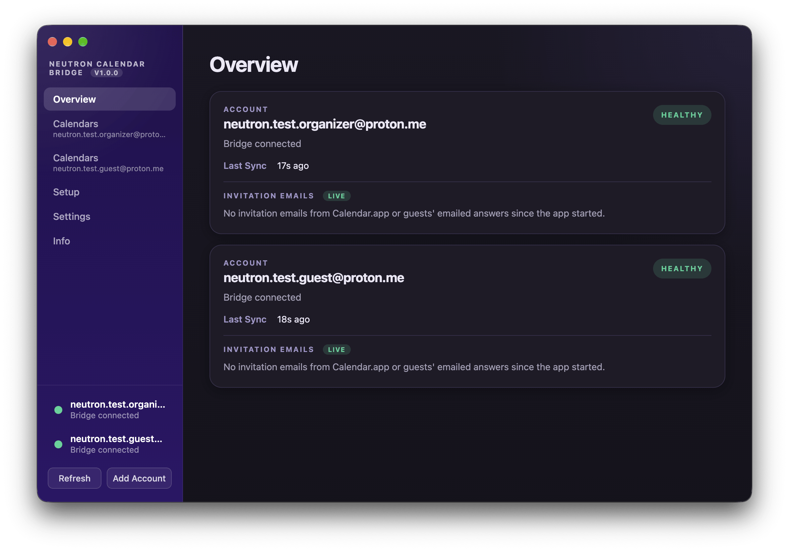</p>

<p align="center">
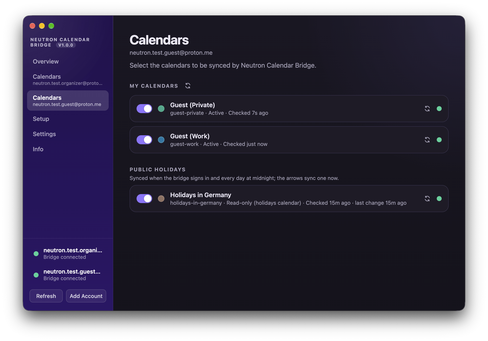
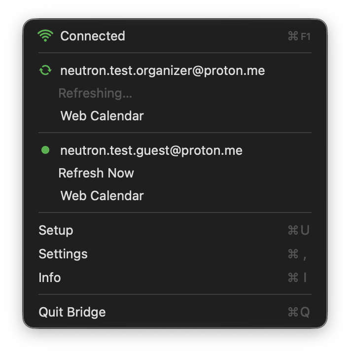
</p>

<details>
<summary>More: sign-in, Setup, Settings, Info, a signed-out account</summary>

<p align="center">
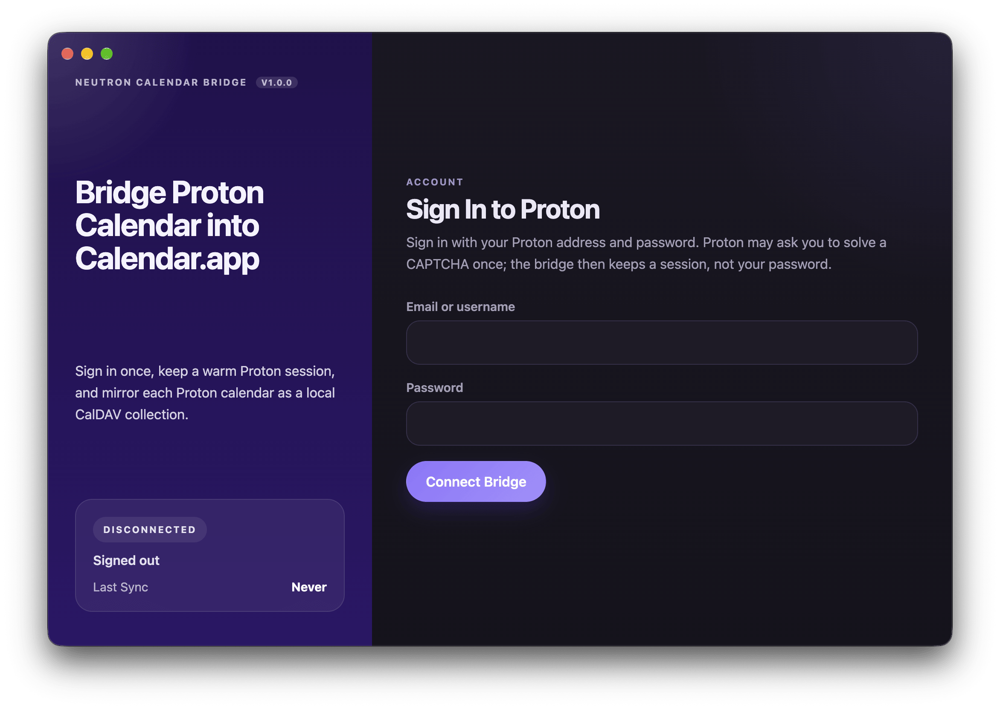
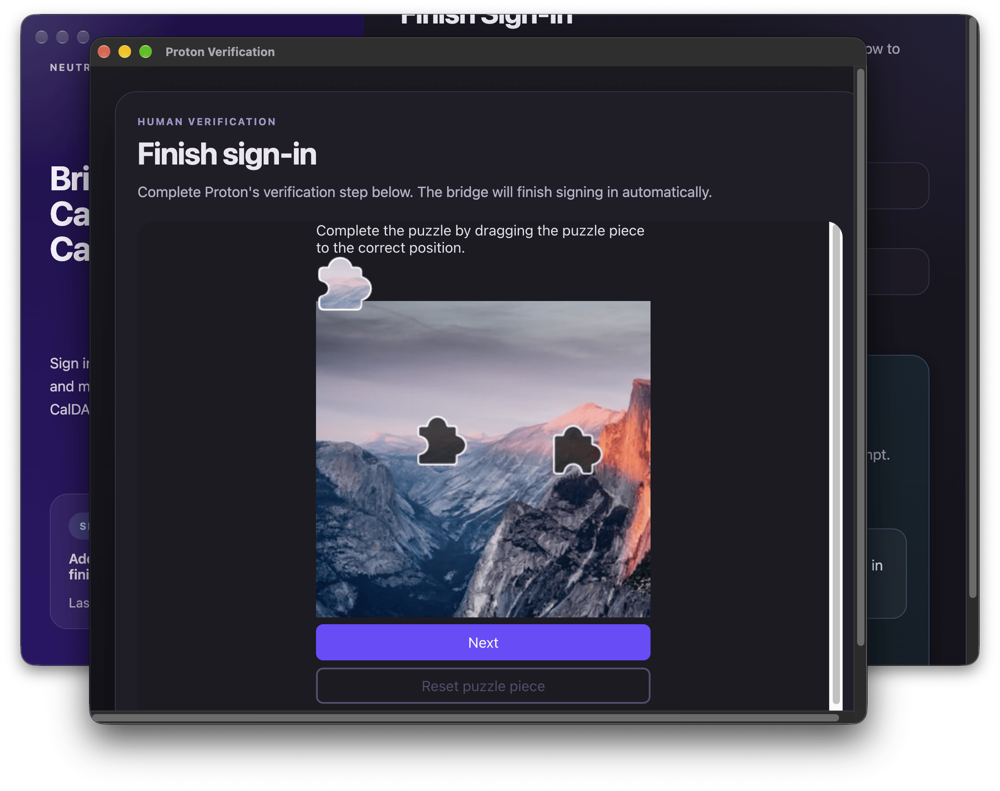
</p>
<p align="center">
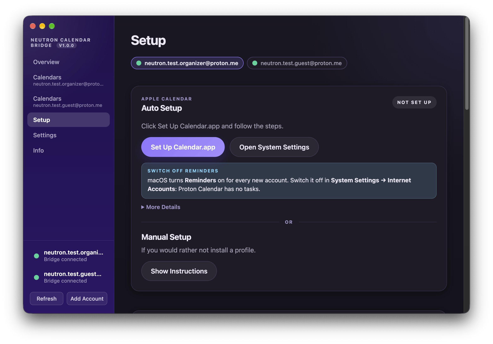
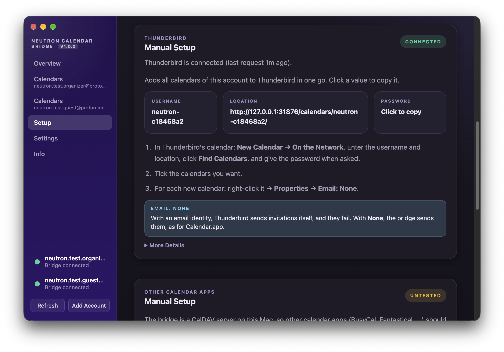
</p>
<p align="center">
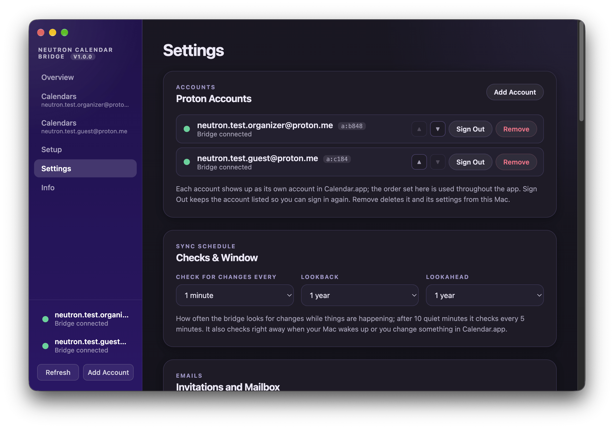
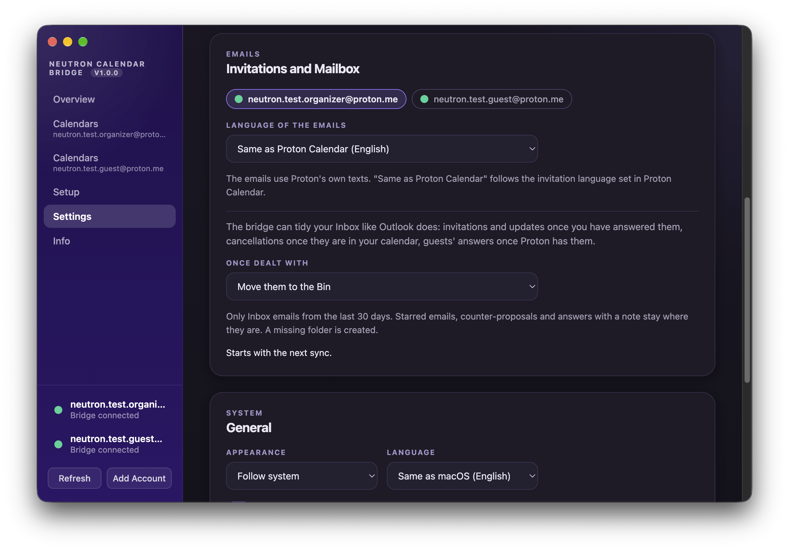
</p>
<p align="center">
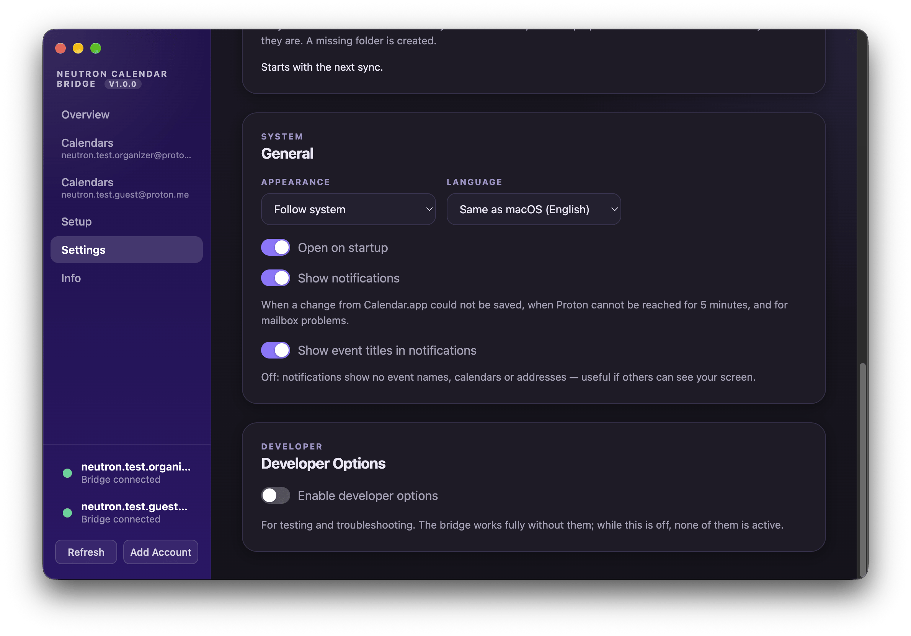
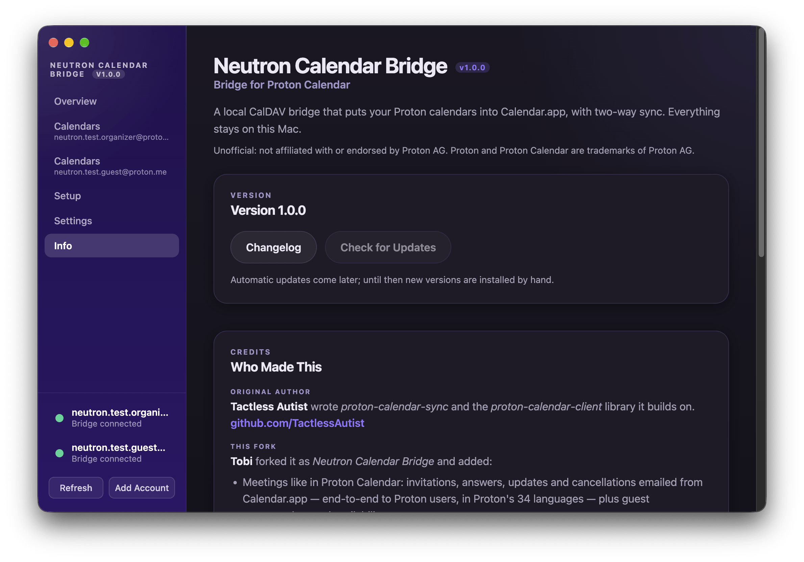
</p>
<p align="center">
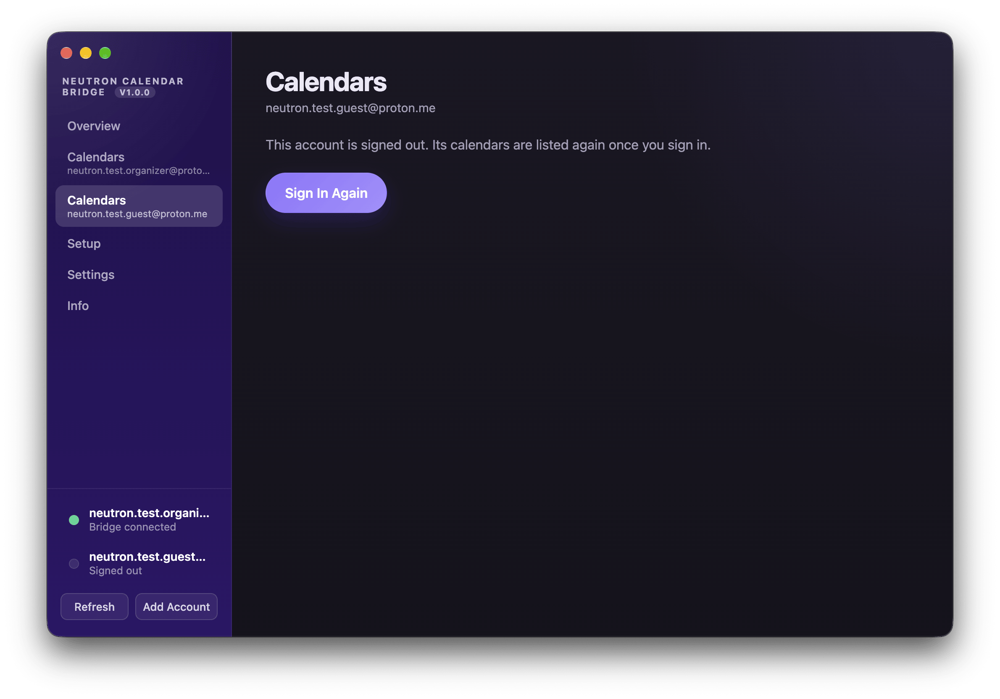
</p>
</details>

The pictures show two Proton test accounts.

## Changes in this fork

- Recurring events sync in both directions: repeat rules, skipped and moved occurrences, edits from Calendar.app.
- Per-calendar selection: untick a calendar to keep it out of Calendar.app.
- One failing calendar no longer stops the others; per-calendar errors are shown in the app.
- Events created in Calendar.app keep their identity (no duplicates in Proton after the next sync).
- Failed Calendar.app requests are answered with a reason, shown on the Overview page and written to `~/Library/Logs/neutron-calendar-bridge/bridge.log`.
- Correct time-zone definitions (real DST rules) in the served ICS; stable output that does not re-sync unchanged events.
- Proton's Sentry telemetry is stubbed out of the bundled client: nothing is reported anywhere.
- Dark mode (light / dark / follow system), version badge, Info page; named after Proton Mail Bridge.
- Meetings and invitations show organizer, guests and answers; guest lists can no longer be wiped by an edit from the Mac.
- All-day events stay all-day in both directions (they used to show as 00:00–00:00 events, and dates written from the Mac could land a day early east of UTC).
- Subscribed, holidays, view-only shared and disabled calendars are read-only in Calendar.app; edits are refused with the reason instead of a 500 that Calendar.app kept retrying.
- Dock icon while the window is open; opening the app brings the window up; the window can be dragged by the top of either side, like by a title bar.
- Menu-bar icon from the moment the app starts, with a menu like Proton Mail Bridge's (left or right click): status (connecting / connected / error, in yellow / green / red; opens the Overview), account (a symbol for the calendars: green dot, a turning sync symbol while syncing (0.32.4: a small native module animates the native menu while it is open), a yellow ring when something was refused, a red "!" on trouble; opens Calendars), Refresh Now (the Refresh button's pass; "Refreshing…" and greyed while one runs), Web Calendar (0.39: per account), Setup, Settings, Info, Quit Bridge, with shortcuts (Cmd-F1 opens the Overview, Cmd-R, Cmd-U, Cmd-comma, Cmd-I, Cmd-W, Cmd-Q; Cmd-W opens Proton Calendar on the web, so it does not close the window). App icon without macOS 26's grey plate: full-bleed artwork (`app-icon-tahoe.icns`), which Tahoe cuts into its own rounded square.
- Invitations can be answered from Calendar.app (Accept / Maybe / Decline, or delete to decline), with the organizer emailed the way Proton Calendar does it; a test mode and a dry run keep emails to addresses you choose.
- Meetings you organize, single and recurring, can be created and changed from Calendar.app: guests get Proton's invitation, update and cancellation emails.
- macOS notifications with the exact reason when Calendar.app's change was refused or only partly saved (Calendar.app itself only says "not permitted"), when Proton cannot be reached for 5 minutes (and when it is back) or keeps refusing to sync, and for mailbox problems; several at once are summed up; Settings → General → Show notifications.
- Syncs right after the Mac wakes up (once Proton answers again), and at once when Proton can be reached again after more than 2 minutes without a connection. Whether Proton is gone or only refusing is told apart by Proton's ping, so a refusal (e.g. too many requests) is not met with more requests. Opened without a connection (e.g. at login before the Wi-Fi is up), it signs in as soon as Proton can be reached.
- A saved login that macOS does not let the app read (Keychain prompt answered "Deny") is left untouched until you sign in again, and then kept aside; a login that was encrypted is never saved in plain text.
- Asks Proton only what changed (0.26): the app follows Proton's change feeds — the ones Proton Calendar itself polls — with one small request for the account and one per calendar, and re-reads just the series that changed; everything is listed in full only at sign-in, once a day, with the Refresh button, or when Proton asks for it. Unchanged events are not decrypted again. Checks come at your interval while things change (Settings → Sync schedule) and every 5 minutes after 10 quiet minutes; at once after waking up, reconnecting or a change from Calendar.app. The calendar list and the mailbox are read only when the feed reports a change there. Developer settings show the passes of the last hour (kind, requests, decryptions, changes) and the cadence.
- Signing in under its own name (0.45): the bridge signs in with your Proton address and password as **Neutron Calendar Bridge** — not, as before, as Proton's iOS Mail app. Proton's rules for third-party apps say an app must identify itself truthfully; Proton has no product name for a third-party calendar client yet, so the bridge uses Proton's generic one ("Other") with its own User-Agent. Proton answers such a sign-in with a CAPTCHA (shown in a window of Proton's own page), then the authenticator code or mailbox password if the account has one. The password is only used for Proton's sign-in protocol (SRP: Proton never receives the password itself) and is **not kept**: the bridge keeps the session (encrypted) and renews it; if Proton ends it, you sign in again. Since 0.50 this is the only identity the bridge and its library have; a session from before 0.45 is not resumed, you sign in once more.
- Sign In with Proton (0.28–0.46) is no longer in the app (0.47): Proton's own sign-in page handed the bridge a session for Proton's web calendar, and the bridge then spoke to Proton as Proton's own apps, which Proton's rules do not allow other apps. The code is parked in a private side repository, ready to come back should Proton offer third-party apps a sign-in through its page. Accounts signed in that way keep their session until Proton ends it; then you sign in again with the form.
- Two-factor authentication and two-password mode (0.27): the Setup page asks for the authenticator code, or the mailbox password, after the password; the derived key is kept with the saved session (encrypted), so a restart needs neither. Security keys are not supported yet (an account with only a security key is told to add an authenticator app).
- Stays signed in like Proton's apps: the session is renewed in the background and resumed at start (no password sign-in while Proton accepts it; kept encrypted with the login); if Proton ends it, an account with a kept password (signed in before 0.45) signs in again once; otherwise you are asked to sign in again. When Proton asks to slow down, every request waits for Proton's time and syncing pauses until then; requests are spread out, reads without an answer are tried again, changes are never sent twice. Developer settings show the request statistics.
- Info page: version, changelog (pop-up), and a "Check for updates" button for later (greyed out).
- Reminders both ways (0.33): an event's Proton notifications (or the calendar's default reminders) are served as alerts, and alerts you add, change or remove in Calendar.app are stored in Proton — display and sound alerts as device notifications, email alerts as email notifications; for a meeting or an invitation the reminders go through Proton's personal part, so changing an alert never emails anyone. Alerts equal to the calendar's defaults count as "the defaults" (so Proton keeps following the calendar's setting); removing all alerts stores "none".
- Several accounts (0.36): Settings → Accounts → Add Account signs in another Proton account; each has its own session, local copy, settings for its calendars and emails, and its own CalDAV account in Calendar.app ("Proton (address)"). The Overview shows a card per account, the side panel every account with its dot, and from the second account on the Calendars tab becomes one tab per account; the accounts' order (Settings) is the order everywhere, the menu-bar menu included (a block per account: address, Refresh Now, Web Calendar for that account — 0.39). 0.46: the menu's colours — the top line shows the connection to Proton (green: at least one account is signed in and Proton answers; blue: connecting, e.g. after the app starts; yellow: Proton asked to slow down; red: no connection or nobody signed in), each account's line how that account is doing (blue until its first sync of this run went through, then green; yellow when something was refused, red when something fails), with a line under it saying what is going on when that is not plain sailing (connecting, waiting for verification, no connection, signed out …). Every account is listed from the start, not only once all have synced. Sign Out keeps an account listed for signing in again; Remove deletes it from this Mac.
- Offline edits (0.35): changes you make in Calendar.app while Proton cannot be reached (no connection, Proton down; 0.40: or while Proton has asked the bridge to slow down) are taken into the local copy at once — Calendar.app shows no error and the event looks saved — and kept on disk until Proton answers again; then they are sent in order, invitations and answers included (emailed then, under the email mode in force). The Overview and the calendar's yellow dot say how many wait. A change Proton refuses once it is back is undone here (Calendar.app shows Proton's version after its next refresh) and reported on the Overview and as a notification. 0.40: a change made during a slow-down waits the same way (only a write already under way when Proton asks to slow down is told to wait); a save from an outdated copy is refused at once (Calendar.app re-reads) instead of waiting to overwrite a newer version. 0.42: renaming or recolouring a calendar waits the same way (before, it was refused while Proton could not be reached). 0.41: when Proton asks to slow down while a change is being emailed, the change is saved and the emails to the remaining guests wait (the Overview counts them); they go out once the pause is over (a newer change of the meeting that reaches those guests replaces them; one that waits longer than a day is reported as not sent).
- Video links (0.34.1): type **Proton Meet** or **Zoom** as the location of an event in Calendar.app and the bridge makes the room when you save — Proton Meet the way Proton Calendar does (the room's password only ever travels in the link; works on free accounts), Zoom through Proton when Zoom is connected in Proton Calendar's settings (otherwise the save is refused with that hint). The saved event has the join link as its location, Proton's "Join Proton Meet: …" block in its description (what guests see in the invitation; 0.41.1: kept out of Calendar.app's notes, as Proton Calendar hides it too) and Proton's conference fields, so Proton Calendar shows its conference widget. A link made in Proton Calendar survives edits in Calendar.app (Calendar.app does not know Proton's conference fields; the bridge puts them back). Renaming the event renames your Proton Meet room, deleting the event removes it; replacing or clearing the location takes the link off the event (0.34.2). A link taken off in Proton Calendar stays off when you edit a repeating event in Calendar.app before the bridge has seen that change (0.41: the series is read again first).
- Thunderbird (0.48.x): works as a CalDAV client too. The Setup page has a "Thunderbird" card: one location per account (its calendar home) finds all its calendars; set **Email: None** in each calendar's Properties so that invitations go through the bridge. Tested: invitations, answers and cancellations both ways, all-day events, alerts.
- Fields Proton has no place for — categories, attachments/links, the privacy class — are dropped on save (links in the description are kept). "Show time as free" (TRANSP) survives the round trip since 0.49.8; a Tentative status does not — Proton's API stores confirmed or cancelled only, so it is saved as confirmed (0.49.12).
- Other CalDAV apps (0.49): the Setup page's "Other Calendar Apps" card gives the principal URL, the calendar home, host, port, username and password with general steps (CalDAV account, no SSL, one account per Proton account, let the bridge send invitations). Untested so far — reports welcome.
- Calendar management from Calendar.app (0.34): renaming or recolouring a calendar in Calendar.app changes it in Proton (your view of it, as in Proton Calendar's edit form — also for calendars shared with you, subscribed and holiday calendars); the colour becomes the nearest of Proton's own calendar colours. A calendar created in Calendar.app (File → New Calendar under the bridge's account) becomes a personal Proton calendar with its own key, ticked and synced right away. Deleting a calendar in Calendar.app takes it out of Calendar.app only (0.37: unticked here, kept in Proton; tick it again on the Calendars page) — since 0.45.6 also subscribed, holiday and view-only calendars (Calendar.app only deletes a calendar whose name and colour it may change, so these can now be renamed and recoloured in Calendar.app too), whose events stay read-only; an account with several addresses chooses which one owns new calendars. The task list Reminders asks every CalDAV account for (0.35.1) is refused, not created: the bridge serves events only — turn off Reminders for the account in System Settings → Internet Accounts to stop the request. 0.48: the bridge also tells Calendar.app that it offers events only (`supported-calendar-component-sets` on the calendar home); macOS still turns Reminders on for a new account (tested), and a configuration profile has no setting for it (Apple's CalDAV payload has none), so the Setup page says to switch it off (0.48.1: a step in the profile's instructions and a note below them). Proton Calendar has no tasks to serve anyway.
- Availability (0.33.2): Calendar.app's availability view for a meeting (the free/busy lookup it sends while you plan one) is answered — your own busy times from the mirrored calendars (every ticked own or shared calendar; repeating events expanded; events marked free, cancelled or declined by you count as free; 0.40: those you answered Maybe, and tentative events, as tentatively busy), and other Proton users' busy times when Proton shares them with your account (Proton does that inside an organization on its Business, Family, Duo, Visionary or Mail Essentials/Business plans; for everyone else, and for addresses outside Proton, Calendar.app shows "no information", as before).
- Guest autocomplete (0.33.1): while you type a guest into a meeting in Calendar.app, the names and addresses of your Proton contacts (and your own addresses) are suggested — Calendar.app's server-side guest search, answered by the bridge from the account's contacts. Only the contacts' addresses and names are used (the ones Proton keeps readable for its own autocomplete); the list is read when first asked for and again after ten minutes.
- The app in six languages (0.32): English, German, Dutch, French, Spanish and Italian — window, menu-bar menu, notifications and the reasons Calendar.app is given. Settings → General → **Language**: "Same as macOS" (the default: macOS's language when it is one of the six, else English) or a fixed one; switches at once. Developer statistics and the library's own error texts stay English.
- Emails about meetings can leave the Inbox once they are dealt with, like in Outlook (Settings → Emails About Meetings: leave them, or move them to the Bin, the Archive or a folder of your choice; details below).
- Developer options (Settings → Developer Options, at the bottom; off by default): extra options for testing and edge cases, active only while "Enable developer options" is ticked. Options: also apply answers that guests outside Proton email to your meetings (Proton normally does this by itself).
- Privacy at rest: the local copy of your calendars is encrypted (SQLCipher, with a random key kept with the saved login in the Keychain); `bridge.log` leaves out event titles, calendar names, email addresses and subjects, email text and calendar files unless "Detailed logging" is on (Developer settings; for 24 hours or until switched off; "Delete the Logs" afterwards); Calendar.app has to sign in with the generated password (a wrong or old one is shown on the Setup page with the right one to enter); notifications can leave event titles out (Settings → General); the app's files are readable by you only. Backups made before 0.24 (Time Machine, snapshots) still hold the unencrypted copy and the old logs. To remove those (0.42): in Time Machine, browse to `~/Library/Application Support/neutron-calendar-bridge` and `~/Library/Logs/neutron-calendar-bridge`, select the folders and choose "Delete All Backups of …" from the action menu; local snapshots are listed with `tmutil listlocalsnapshots /` and removed with `sudo tmutil deletelocalsnapshots <date>` (they also expire on their own within a day).
- Calendars page in groups (My Calendars, Shared with me, Subscribed Calendars, Public Holidays) with a status symbol per calendar (green dot; a yellow ring when Calendar.app asked for something the bridge refused, until you sync that calendar by hand; a red "!" when its sync fails or Proton cannot be reached; hover or click for the reason) and sync buttons for one calendar or a whole group, with a queue you can take calendars off again. Public holidays are synced at sign-in and once a day at midnight, not by Refresh. Setup page with one-click Calendar.app setup (0.30: a configuration profile macOS installs; "Connected" once Calendar.app signs in) and the connection values for setting it up by hand.

## Why this exists

Proton Bridge does for mail what nothing official does for calendar: give a local, standard-protocol endpoint that native apps can talk to. If you want Proton Calendar in Calendar.app — alongside your other accounts, with widgets, notifications, and offline access — the official answer is a browser tab. That hole is exactly the shape of "Bridge, but CalDAV". This is that.

Everything stays local. The app talks to Proton's API directly (E2E decryption happens on your machine via the client library) and exposes CalDAV only on 127.0.0.1 with generated Basic-auth credentials. No third-party server ever sees your events. Web pages cannot reach that server (requests from a browser and host names other than this Mac's own are refused).

## How it works

- `src/main/proton-adapter.ts` — wraps the library in `client/` (proton-calendar-client): login (including CAPTCHA/human-verification via an embedded Proton page), session handling, event CRUD
- `src/main/mirror-database.ts` — local mirror of calendars and events (SQLite, encrypted with SQLCipher)
- `src/main/private-log.ts` — quiet logs: what is private is left out of `bridge.log` unless detailed logging is on
- `src/main/caldav-server.ts` — an Express CalDAV server (PROPFIND/REPORT/sync-token, Apple calendar-color namespace) bound to localhost
- `src/main/bridge-service.ts` — the sync engine reconciling Proton and local edits in both directions
- `src/main/secret-store.ts` — the saved login, Proton's session, the CalDAV password and the key of the local copy, encrypted with a key in the macOS Keychain (Electron safeStorage)

## Building from source

You need macOS, Node.js 20 or newer, and the Xcode Command Line Tools (`xcode-select --install`): the encrypted local copy (SQLCipher) is compiled during `npm install`, and `npm run build` compiles the small native module that turns the sync symbol in the menu-bar menu (`native/menu-spinner`). The library is an npm workspace in `client/`, so one install at the top covers both (the library's `prepare` script builds it):

```bash
git clone https://github.com/to-bi-s/neutron-calendar-bridge.git
cd neutron-calendar-bridge
npm install
npm run check        # library build + its offline tests, bridge tests, texts and catalogs, bridge build
npm start            # runs the bridge from the checkout
```

The lock file is committed; `npm ci` installs exactly those versions. `npm run check` is the gate before every change: it runs the library's build and offline tests, the bridge's tests (`npm test` alone runs just those), the texts-and-catalogs check (every text of the window and the code has its entry in the five language catalogs) and the bridge build, and stops at the first failure.

A packaged app:

```bash
npm run package:mac  # → release/Neutron Calendar Bridge-<version>-arm64.dmg and …-x64.dmg (both architectures, from either kind of Mac), the .zip files and latest-mac.yml the installed apps update from
```

This build is not signed or notarized (unless a Developer ID certificate is in your Keychain, which electron-builder then uses). macOS therefore blocks the first start: right-click the app in Applications → **Open**, or allow it under System Settings → Privacy & Security after the first refusal. The app keeps its data in `~/Library/Application Support/neutron-calendar-bridge` and its log in `~/Library/Logs/neutron-calendar-bridge/bridge.log`.

### Signed builds

A build that opens on any Mac without a warning is signed with a Developer ID and notarized by Apple. It needs an Apple Developer Program membership and two things in your login Keychain, set up once:

1. **The certificate**: Xcode → Settings → Accounts → (your Apple ID) → Manage Certificates → **+** → **Developer ID Application**. `security find-identity -v -p codesigning` then lists "Developer ID Application: *Name* (*Team ID*)".
2. **Notarization credentials**: create an app-specific password at [account.apple.com](https://account.apple.com) (Sign-In and Security → App-Specific Passwords), then store it under a profile name (the command asks for the password; nothing is written to the repository):

   ```bash
   xcrun notarytool store-credentials neutron-notary --apple-id <your Apple ID> --team-id <Team ID>
   ```

Then:

```bash
npm run package:mac:release   # signed, notarized and stapled app and DMG, checked as Gatekeeper checks them
npm run package:mac:quick     # for testing: the app as above, the DMG only signed (one wait for Apple instead of two)
```

The app is signed with the hardened runtime and `resources/entitlements.mac.plist` (only what Electron's JavaScript engine needs; library validation stays on, since every native module is signed with the same certificate). `NEUTRON_NOTARY_PROFILE` picks another profile name. Notarization usually takes a few minutes per upload (the app, then the DMG; `--quick` skips the DMG's). Builds given to others go through the full release. CI builds stay unsigned.

### Continuous integration

GitHub Actions (`.github/workflows/`): **Check** on every push and pull request — `npm ci` and `npm run check` on Linux in two time zones (Europe/Amsterdam, Pacific/Auckland), plus the window harnesses in Electron under Xvfb (screenshots as an artifact); **macOS** weekly and when the native module, `package.json` or the lock change — the native module compiled with Xcode, `npm run check` on macOS, the unsigned DMG built and its bundle checked (identifier, version, native modules, the library's `dist/`), the DMG kept for three days; Live tests (the library's scenarios and the bridge's two-account run against the Proton test accounts) run on a Mac from sessions seeded by hand (`npm run seed:sessions`; Proton's CAPTCHA), not in Actions. On a private repository macOS minutes count ten times, hence Linux for the per-push gate.

## Setting up Calendar.app

<p align="center">
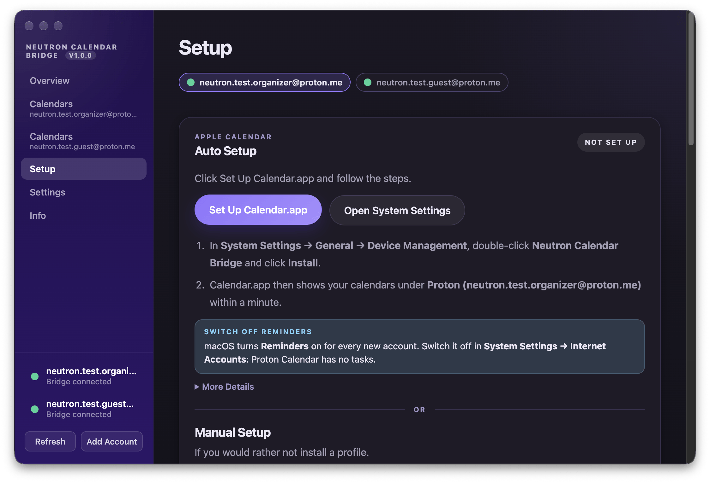
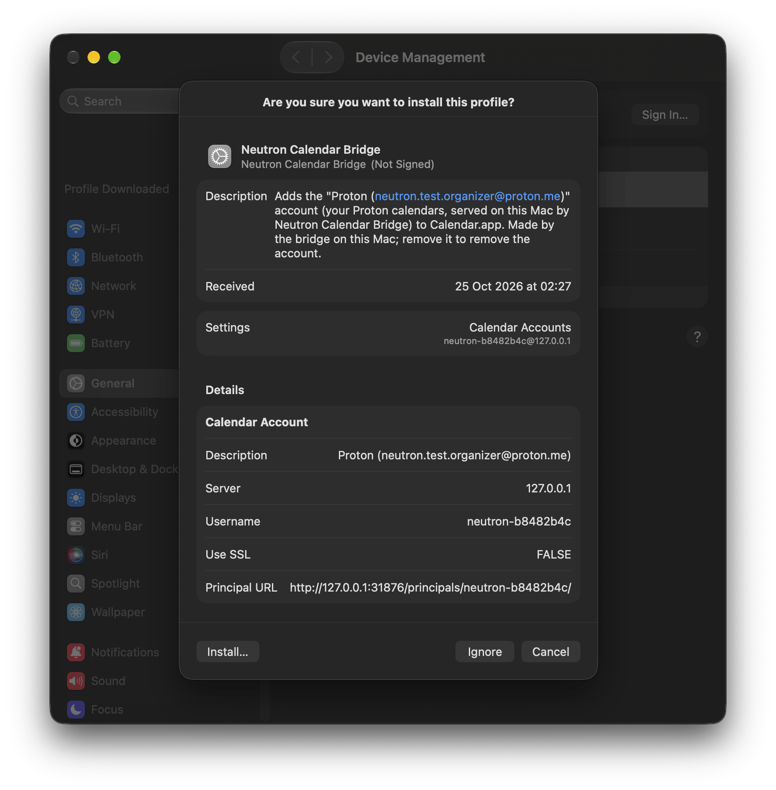
</p>

Sign in on the app's Setup page with your Proton address and password (Proton may show a CAPTCHA once, then asks for your authenticator code if you use one; the password is not kept), then click **Set Up Calendar.app**: the bridge writes a configuration profile with its account (host 127.0.0.1, port, user name, password, principal URL) and hands it to macOS; install it in System Settings → General → Device Management (Privacy & Security → Profiles on macOS 13/14; the profile shows as "not verified" — it is made on your Mac, not signed by Apple), and Calendar.app shows your Proton calendars under an account called "Proton". The page says "Connected" once Calendar.app has signed in to the bridge. Removing the profile removes the account. The values for adding the account by hand (Other CalDAV Account) are in the same card under "Manual Setup" → Show Instructions.

<p align="center">
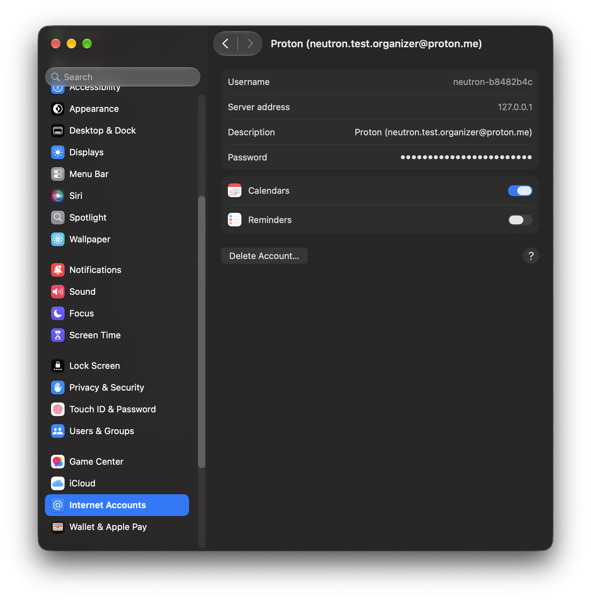
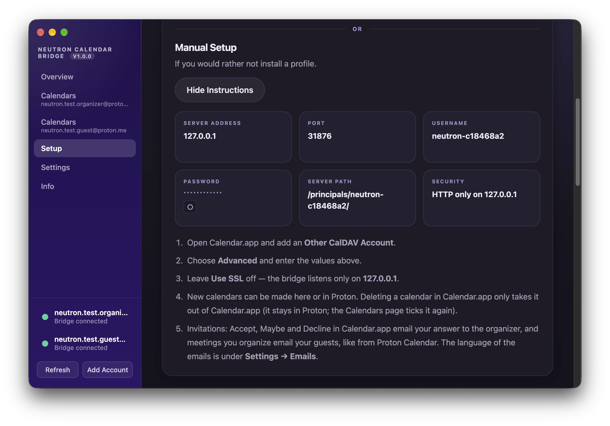
</p>

## Setting up Thunderbird and other apps

The Setup page's **Thunderbird** card gives one location per account (its calendar home) that finds all its calendars at once: in Thunderbird's calendar, New Calendar → On the Network, enter the user name and location, click Find Calendars and give the password when asked; tick the calendars you want. Then, for each new calendar, right-click it → Properties → **Email: None** — with an email identity Thunderbird would send invitations itself, and they fail; with None the bridge sends them through Proton, as for Calendar.app. The card says "Connected" once Thunderbird has signed in to the bridge. The **Other calendar apps** card has the same values laid out for any CalDAV client (server URL, user name, password; server address, port and calendar home for apps that ask separately); only Calendar.app and Thunderbird have been tried.

<p align="center">
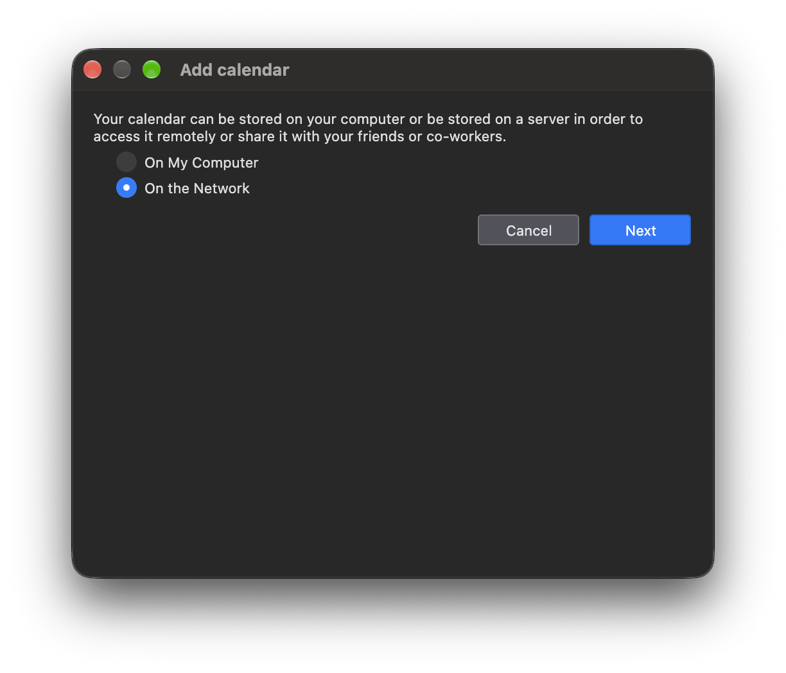
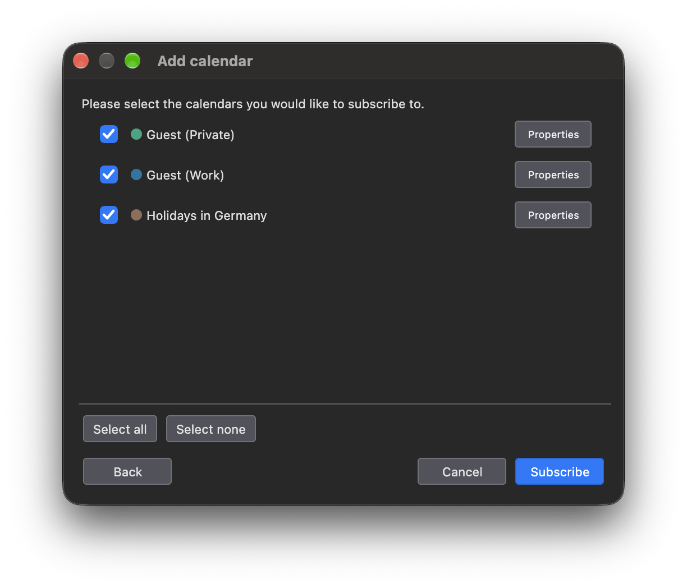
</p>
<p align="center">
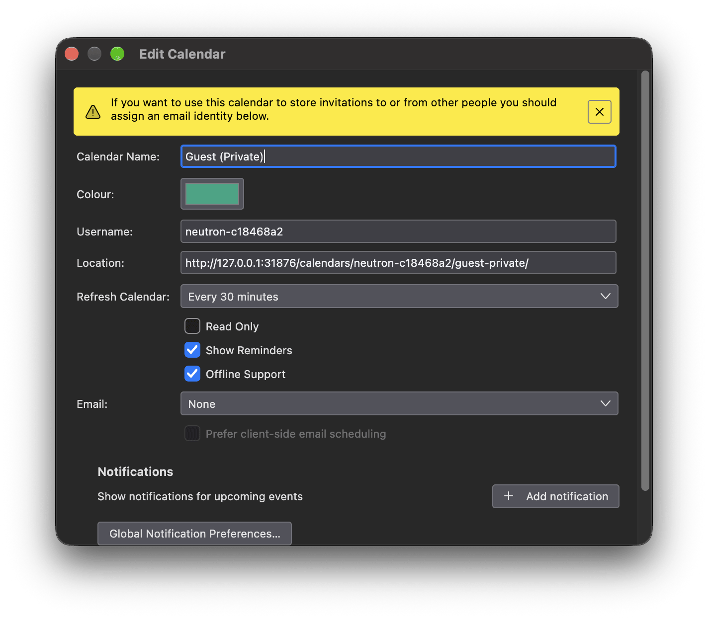
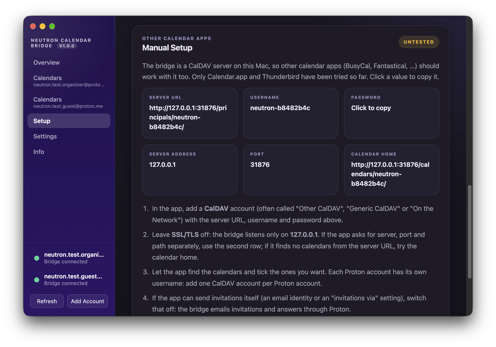
</p>

## Updating

Since 1.0.2 the installed app updates itself from the Releases page (see [Install](#install)); the Info page shows what it found and the menu-bar menu offers **Restart to Update** once a version is downloaded. By hand it still works the old way: quit the bridge (menu-bar icon → Quit Bridge), replace the app in Applications, open it. At the first start of a version signed differently from the one before (an unsigned build replaced by a signed one, say) macOS asks whether the app may use the Keychain item "neutron-calendar-bridge Safe Storage": choose **Always Allow** (if you chose Deny, quit, reopen and choose Always Allow: the saved login is left untouched until then). Your data, saved login and Calendar.app accounts carry over between versions; the CHANGELOG says when a version needs more.

## Limitations

- macOS-first. The CalDAV server itself is portable, but packaging and keychain integration target macOS (Calendar.app was the itch).
- Depends on unofficial API access via proton-calendar-client; Proton can break it at any time. Use your own account, at your own risk.
- Recurring events sync in both directions (repeat rule, skipped and moved occurrences). Editing a series in Calendar.app needs the library in `client/` built from the same checkout; with an older client the bridge refuses such writes instead of flattening the series in Proton.
- Reminders (0.33): Proton's notifications show as alerts in Calendar.app and alerts set in Calendar.app become Proton notifications (details below). What Proton cannot keep is left out: alerts after the start, location-based alerts, more than 10.
- Invitations: meetings and invitations show their organizer, guests and everyone's answer in Calendar.app; invitations can be answered and meetings you organize (single and recurring) can be created, changed and cancelled from the Mac (details below). What Proton Calendar itself would not do is refused with the reason (the bridge answers 403, shown on the Overview page). Moving a meeting with guests to another calendar is refused (Calendar.app does it as copy + delete, which would invite and then cancel everyone); move it in Proton Calendar.
- CalDAV surface implements what Calendar.app needs, not the full RFC 4791.
- The CalDAV server only listens on 127.0.0.1 and over plain HTTP (nothing leaves the Mac); programs on this Mac need the generated password (Digest or Basic authentication; Calendar.app uses Digest, as it never sends Basic credentials without TLS), web pages cannot reach it at all. The calendars are decrypted in the app's memory while it runs.

## Answering invitations

Accept, Maybe and Decline in Calendar.app do what the same buttons do in Proton Calendar: your answer is saved in Proton and emailed to the organizer (an iCalendar `REPLY`). The email is built and encrypted by the client library with Proton's own code and sent through your Proton account: end-to-end to Proton users, PGP where the organizer's key is pinned in your contacts, normal email to everyone else. Deleting an invitation declines it (the organizer is told only if you had said yes or maybe, and not when Calendar.app asks not to notify), then removes it — for a recurring invitation, the whole series.

What Proton itself cannot do is refused with the reason: answering one occurrence of a series on its own (Proton takes one answer for the series, plus answers for occurrences the organizer changed), "no answer" or delegating.

## Meetings you organize

Inviting people to an event in Calendar.app does what Proton Calendar does: the event is saved in Proton with you as the organizer (the calendar's address) and the guests get an invitation (`REQUEST`), Proton users end-to-end and with the event added to their Proton calendar. Later changes follow Proton's rules: a new time, title, place or notes sends everyone an update (answers are reset when the time changes); adding or removing guests sends only them an invitation or a cancellation; deleting the meeting sends everyone a cancellation (`CANCEL`), unless Calendar.app is told not to notify. Guests' answers always come from Proton, never from Calendar.app's copy, and a save from an outdated copy is refused (412) so it cannot remove a guest added in the meantime.

A new guest who cannot be invited — not on the test-mode allowlist, or an address Proton cannot email (e.g. a Proton address that does not exist) — is left out, like Proton's "continue without": the meeting is saved and the other guests are emailed. Calendar.app shows a refusal and then reloads the saved meeting without that guest; the reason is on the Overview page and the calendar's dot turns yellow. Refused with the reason, before anything is sent: two addresses of the same person, inviting from a calendar someone shared with you, an organizer that is not one of your addresses, and a change that would email a guest who is already invited but not on the test-mode allowlist.

### Recurring meetings

Proton Calendar asks whether a change is for "all events" or "this event"; Calendar.app instead sends its whole new version of the series. The bridge reads what changed and does what Proton Calendar does for that choice:

- **The series itself** (time, repeat rule, title, place, notes, guests): like "all events". A new title, place or notes goes to everyone and into occurrences you had changed before (one email each). A new time or repeat rule resets everyone's answers, and occurrences you had changed before are cancelled and removed (Proton's rule). Guests are always changed for the whole series.
- **One occurrence changed** ("this event only" in Calendar.app): an update for that date.
- **One occurrence deleted**: a cancellation for that date. Deleting the whole meeting cancels the series and each changed occurrence.
- **"All future events"** in Calendar.app splits the meeting in two, which Proton Calendar does not offer for meetings: the old series ends at that date (an update for everyone, answers reset, its changed occurrences cancelled) and the rest becomes a new meeting with a new invitation. Change the whole series instead if you want to keep answers.

Refused with the reason: guests changed for one occurrence only, bringing back a deleted occurrence, undoing a change to one occurrence, and changing several occurrences in one save (change them one at a time). Notes guests added to their answer are not carried into an occurrence you change.

### Answers from guests outside Proton

Proton guests answer straight into your event. Everyone else answers by email, and Proton records those answers by itself, usually within a minute or two (tested in October 2026: also when the reply is never opened in Proton Mail), and Calendar.app shows them at the next sync. Nothing to set up.

As a safety net there is a developer option, **Settings → Developer Options → Apply answers that guests outside Proton send by email** (off by default, and only active while "Enable developer options" is ticked). With it on, at the start of each sync the bridge does what Proton Mail would: it looks at the emails with a calendar attachment that arrived since the last sync (the first time, or after a longer break: the last 30 days; never trash, and spam only as below), decrypts them on this Mac and applies replies to meetings you organize, for the guest who sent the email. Like Proton Mail it leaves out answers to an older or newer version of the meeting, to a cancelled meeting or to one occurrence, and answers older than the one Proton has; stricter than Proton Mail, it also leaves out emails that fail DMARC or that Proton marked as phishing or suspicious. The guest is matched the way Proton identifies guests (Gmail without the dots is the same person, `john.smith@` and `johnsmith@` at other providers are not); a sender that only loosely matches a guest is listed with the reason, open that reply in Proton Mail to apply it. Nothing is sent and the emails are not touched (they stay unread). Each answer is listed on the Overview page and in `bridge.log`, with the reason when it was not applied (replies about meetings that are not in your calendars, e.g. deleted ones, only in `bridge.log`); in dry-run mode answers are only listed. At most 25 emails are opened per sync, so a long backlog is worked through over a few syncs. 0.41: a reply in spam is used when it answers an invitation the bridge sent (its In-Reply-To names that email), and every few hours the last week is looked through again, so a reply you move out of spam later is picked up too. A guest's note with the answer ("Running late") is shown with it on the Overview. Coming from 0.18 (where this was on under Settings → Invitations), it starts off.

## Emails about meetings

**Settings → Emails About Meetings** decides what happens to invitations, updates, cancellations and guests' answers in your Inbox once they are dealt with: leave them (the default), or move them to the Bin, the Archive or a folder (default "Calendar", created if it does not exist; top level only). After each sync the bridge looks at the emails with a calendar attachment in your Inbox from the last 30 days and moves those that are dealt with:

- an invitation or update once it is in your calendar and you have answered it (Accept / Maybe / Decline here or in Proton), or once a newer version has replaced it;
- a cancellation once the meeting (or the occurrence) is cancelled or gone in your calendar;
- a guest's answer to a meeting you organize once Proton has it (Proton records outside guests' answers by itself within a minute or two), or once a newer answer from that guest is in Proton;
- emails about a meeting the bridge saw leave your calendar (you deleted it, or declined and removed an invitation in Calendar.app), as long as nothing of that meeting is left in your calendars.

The rules follow what Proton Mail would still do when you open the email (it would apply an update, a cancellation or an answer): if anything is still to be applied, the email waits. These always stay in the Inbox: invitations you have not answered, starred emails, counter-proposals ("propose new time") and answers with a note in the calendar file (Proton keeps neither), answers to meetings that are not in your calendars (e.g. organized from another calendar app with your Proton address), emails failing DMARC or marked as phishing, and anything the bridge cannot tell. Each move, and why an email stays, is written to `bridge.log`; Settings shows how many were moved since the app started and how many wait. A note a guest wrote only in the text of the email (not in the calendar file) is not looked at: pick Archive or a folder rather than the Bin if that matters to you. Test and live mode move the emails; in dry-run mode they are only listed in `bridge.log`. The bridge reads only what it needs (decrypted on this Mac) and changes nothing else: no read marks, no answers, nothing sent.

## Email settings

Emails go out like from Proton Calendar (**live**). For testing, **Settings → Developer Options → Invitation emails** offers two other modes, in force only while developer options are on (0.32.3; before, test mode was the default and the setting sat under Invitations):

- **Test**: only to the addresses you list. A change that would email anyone else — an organizer or a guest — is refused as a whole; nothing changes in Proton. With an empty list, no email goes out at all.
- **Dry run**: nothing is sent and nothing changes; the emails that would have gone out are listed on the Overview page and in `bridge.log` (their text and calendar file only with Detailed logging on).

While one of them is in force, the Emails card in Settings says so.

Every email (sent, blocked, dry run, failed) is listed on the Overview page and written to `bridge.log`. Emails are only sent for something you did in Calendar.app, never during a sync. Recipients' keys are taken from Proton's key server (and your contacts) without Proton's extra key-transparency check.

**Language of the emails** (Settings → Emails; 0.31): the emails use Proton's own wording and Proton's own translations (taken from Proton's open-source web app, 34 languages). "Same as Proton Calendar" (the default) follows the *Invitation language* in Proton Calendar's settings, and the account's language when that is not set; or pick a language.

## Languages

The app's own texts come in English, German, Dutch, French, Spanish and Italian (Settings → General → Language; "Same as macOS" follows the Mac's language). English is the source text; the other languages are catalogs in `src/locales/<code>.json` (English text → translation, `{name}` placeholders kept, plurals as `one|other`). A missing entry falls back to English. `npm run strings` collects the texts from the code and the window into `src/locales/keys.json` and reports what each catalog is missing; `npm run check` fails on a missing or mismatched entry; `npm run test:i18n` applies every catalog to the built window in Electron and reports anything that stayed English. The invitation emails are a separate matter: they use Proton's own translations in 34 languages (Settings → Emails → Language of the emails).

## License

GPL-3.0-only. Original work copyright Tactless Autist; modifications copyright Tobi. The Proton client library it embeds is GPL-3.0, so the packaged app is too.
